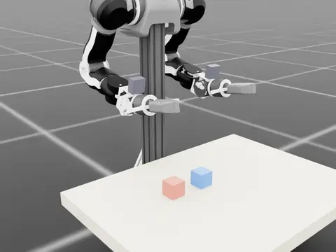
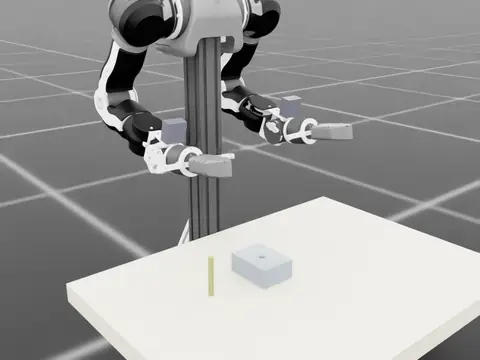
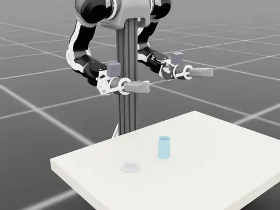
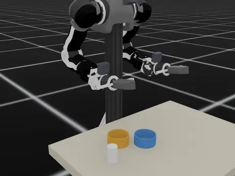
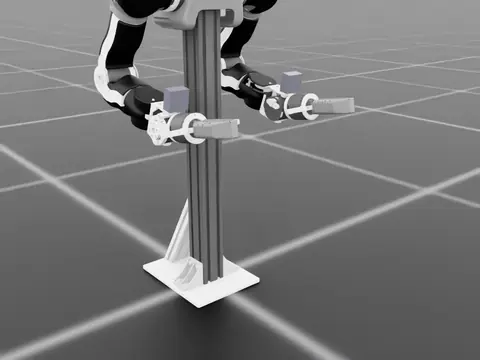

# AIRSEAI 2.0

AIRS's open-source embodied-AI platform, 2.0: a dual-arm
manipulator with vision-based tactile sensors, one data pipeline, and two
places it runs — sim and the real robot.

**In simulation, this repository.** A bimanual OpenArm with four tactile
fingers in Isaac Sim, a scripted expert per task, LeRobot v3 datasets
carrying the tactile channels, ACT training on them, and policy rollout in
the same scenes.

**On the real robot.** The same arms, the same recorded keys, collected by
leader-follower teleoperation. Sim and real do not line up everywhere, and
quantifying where they part is why the benchmark exists.

## The tasks

| | | |
| :---: | :---: | :---: |
|  |  |  |
| `stack_cube` — stack one cube on another | `blind_peg_insertion` — insert a peg into a hole that is not where the robot is told | `sleeve_on_shaft` — slide a squeezable sleeve onto a shaft |
|  |  | |
| `texture_sort` — sort two balls that differ only in surface, in the dark | `handover` — hand a spring-loaded sleeve between the arms, from one cup to the other | |

---

## 1. Requirements

| | version |
| --- | --- |
| GPU | NVIDIA, ≥ 10 GB VRAM |
| disk | ~25 GB free (Isaac Sim is ~18 GB) |
| driver | ≥ 580 |
| OS | Ubuntu 22.04 |
| Isaac Sim | 5.1.0.0 |
| Isaac Lab | v2.3.2 (`isaaclab` 0.54.2) + `isaaclab_contrib` (TacSL) |
| Python | 3.11 |
| PyTorch | 2.7.0+cu128 |
| lerobot | 0.5.1, compatible source installed in `airseai` (dataset format v3.0) |

## 2. Robot asset

The robot asset comes from enactic's
[openarm_isaac_lab](https://github.com/enactic/openarm_isaac_lab). The
installer prepares the bimanual robot with four GelSight fingers and
wrist/head cameras at `assets/usds/openarm_bimanual/openarm_tactile.usd`.

## 3. The environments

Six registered scenes (every task in the registry, plus `minimal`); the clips
at the top of this file show one demonstration of each task scene:

| `--env` | what it is |
| --- | --- |
| `minimal` | the robot and its four tactile fingers, no furniture. The reference scene for anything that looks like a sensing bug |
| `stack_cube` | pick up a cube and stack it on a second one. The template every task layer copies |
| `blind_peg_insertion` | pick up a peg, find a close-fitting hole by touch under an injected pose error, insert it |
| `sleeve_on_shaft` | slide a split sleeve onto a shaft, gripping hard enough to carry it but not so hard its bore closes |
| `texture_sort` | tell two similar-looking balls apart by surface and sort them, in light too dim to see the texture |
| `handover` | pinch a spring-loaded split sleeve out of the orange cup with the left arm, hand it to the right arm, and seat it over the key in the teal cup, holding it open just enough to fit |

## 4. The pipeline

```text
0 install → 1 preview → 2 collect → 3 convert → 4 train → 5 evaluate
```

### Stage 0 — install

#### NVIDIA driver

Skip this step if a compatible driver is already installed.

```bash
sudo add-apt-repository universe && sudo apt update
sudo apt install -y nvidia-driver-580-server
sudo reboot
```

#### Conda

Skip this step if conda is already installed.

```bash
sudo apt install -y curl
curl -fL -o Miniconda3-latest-Linux-x86_64.sh https://repo.anaconda.com/miniconda/Miniconda3-latest-Linux-x86_64.sh
bash Miniconda3-latest-Linux-x86_64.sh -b -p "$HOME/miniconda3"
```

#### Install the airseai-2.0

```bash
sudo apt install -y git
git clone git@github.com:AIRSEAI/AIRSEAI-2.0.git ~/AIRSEAI-2.0
cd ~/AIRSEAI-2.0
bash scripts/install_airseai.sh
```

The installer asks for four settings. Press Enter to accept the displayed default.

| Prompt | Meaning | Default |
| --- | --- | --- |
| `conda env name` | Environment to create or reuse | `airseai` |
| `conda root` | Conda installation directory | Detected installation, falling back to `~/miniconda3` |
| `repo dir` | AIRSEAI repository directory | Repository containing the installer |
| `output root` | Directory for generated files | `outputs/` under the selected `repo dir` |

#### Activate the installed environment

After installation completes successfully, activate the environment in the
terminal used for the remaining stages:

```bash
source ~/miniconda3/etc/profile.d/conda.sh
conda activate airseai
```

The selected output root is saved as `OUTPUT_ROOT` in this conda environment
and loaded automatically on activation.

### Stage 1 — preview an environment

```bash
# Interactive viewer
python benchmark/run/launch_env.py --env stack_cube --gui

# Headless snapshot or video
python benchmark/run/launch_env.py --env stack_cube \
    --snapshot "$OUTPUT_ROOT/preview/stack_cube.png"
python benchmark/run/launch_env.py --env stack_cube \
    --video "$OUTPUT_ROOT/preview/stack_cube.mp4"
```

### Stage 2 — collect demonstrations

#### Scripted expert

```bash
RENDER=1 PREVIEWS=1 bash scripts/run_collect.sh stack_cube 50 \
    "$OUTPUT_ROOT/raw/stack_cube_expert"
```

Or collect 200 episode attempts with four environments on two GPUs:

```bash
NUM_ENVS=4 GPUS=0,1 SEED=7 RENDER=1 PREVIEWS=1 \
    bash scripts/run_collect.sh stack_cube 200 \
    "$OUTPUT_ROOT/raw/stack_cube_expert_parallel"
```

`NUM_ENVS=4 GPUS=0` runs four environments on one GPU if memory permits.
The count is the total episode attempts across all environments; accepted
episodes are automatically combined into one dataset.

| Option | Meaning / default |
| --- | --- |
| `NUM_ENVS` | Concurrent environments; `1` |
| `GPUS` | GPU IDs, distributed round-robin; `0` |
| `SEED` | Collection seed; `7` |
| `RENDER=1` | Record review videos |
| `PREVIEWS=1` | Include tactile preview streams |

| Output | Single-environment example |
| --- | --- |
| Raw dataset | `$OUTPUT_ROOT/raw/stack_cube_expert/` |
| Episode report | `$OUTPUT_ROOT/raw/stack_cube_expert_run/stack_cube_scripted.json` |
| Review videos | `$OUTPUT_ROOT/raw/stack_cube_expert/review/third_person/` |

For the parallel example, replace `stack_cube_expert` with
`stack_cube_expert_parallel`; worker logs are under
`$OUTPUT_ROOT/raw/stack_cube_expert_parallel_run/workers/worker_<id>/`.

#### Keyboard teleoperation

```bash
python benchmark/teleop/run_teleop.py --task stack_cube \
    --teleop_device keyboard --episodes 10 \
    --dataset "$OUTPUT_ROOT/raw/stack_cube_teleop"
```

Omit `--dataset` to practise without recording. `--episodes` counts attempts;
the report records manual success marks and task criterion results separately.

| Output | Path |
| --- | --- |
| Raw dataset | `$OUTPUT_ROOT/raw/stack_cube_teleop/` |
| Episode report | `$OUTPUT_ROOT/raw/stack_cube_teleop_run/stack_cube_teleop.json` |
| Review videos | `$OUTPUT_ROOT/raw/stack_cube_teleop/review/third_person/` |

### Stage 3 — convert and combine datasets

Combine the expert and keyboard recordings from stage 2:

```bash
DATASET=stack_cube_mixed bash scripts/run_convert.sh \
    "$OUTPUT_ROOT/raw/stack_cube_expert" \
    "$OUTPUT_ROOT/raw/stack_cube_teleop"
```

For the parallel expert recording, replace `stack_cube_expert` with
`stack_cube_expert_parallel`. One or more input directories are accepted;
`DATASET` names the combined output. Source recordings remain unchanged.
Inputs must have compatible task, action, and observation definitions.

| Option | Meaning / default |
| --- | --- |
| `DATASET` | Output dataset name; required for multiple inputs, otherwise the input directory name |
| `VARIANTS` | Space-separated variants; `vision tacff tacrgb` |
| `FORCE=1` | Regenerate existing outputs; otherwise skip them |

| Variant | Inputs | Combined output |
| --- | --- | --- |
| `vision` | Cameras and robot state | `$OUTPUT_ROOT/datasets/stack_cube_mixed_vision/` |
| `tacff` | Vision plus force-field images | `$OUTPUT_ROOT/datasets/stack_cube_mixed_tacff/` |
| `tacrgb` | Vision plus tactile RGB images | `$OUTPUT_ROOT/datasets/stack_cube_mixed_tacrgb/` |

All variants contain the same combined episodes and actions. Each output
includes `meta/source_episodes.json` mapping episodes to their source
recording, and review videos under `review/third_person/`.

### Stage 4 — train a policy

```bash
DATASET=stack_cube_mixed VARIANT=tacff POLICY=act GPU=0 \
    STEPS=50000 SEED=1000 bash scripts/run_train.sh
```

| Option | Meaning / default |
| --- | --- |
| `DATASET` | Dataset name from stage 3 |
| `VARIANT` | `vision`, `tacff`, or `tacrgb` |
| `POLICY` | LeRobot policy type; `act` |
| `GPU` | Training GPU |
| `STEPS` | Training steps; `50000` |
| `SEED` | Training seed; `1000` |

ACT is the initial baseline. Other model families may require additional
model configuration and dependencies.

- Checkpoints: `$OUTPUT_ROOT/outputs/stack_cube_mixed_tacff_act_s1000/checkpoints/`.
- Log: `$OUTPUT_ROOT/logs/train_stack_cube_mixed_tacff_act_s1000.log`.

### Stage 5 — evaluate

#### Evaluate with existing initial states

Every evaluation uses a saved initial-state file. Start with the published
50-state set for the task:

```bash
CKPT="$OUTPUT_ROOT/outputs/stack_cube_mixed_tacff_act_s1000/checkpoints/last/pretrained_model"
INIT_STATES=meta/init_states/stack_cube.json VIDEO=1 \
    OUT="$OUTPUT_ROOT/eval/stack_cube_mixed_tacff_act_s1000" \
    bash scripts/run_eval.sh stack_cube "$CKPT"
```

For four environments on two GPUs, use the same state file:

```bash
INIT_STATES=meta/init_states/stack_cube.json \
    NUM_ENVS=4 GPUS=0,1 SEED=11 VIDEO=1 \
    OUT="$OUTPUT_ROOT/eval/stack_cube_mixed_tacff_act_s1000_parallel" \
    bash scripts/run_eval.sh stack_cube "$CKPT"
```

Both commands evaluate every state once. `NUM_ENVS=4 GPUS=0` places all four
environments on one GPU if memory permits. A missing state file stops the run.

| Option | Meaning / default |
| --- | --- |
| `INIT_STATES` | Initial-state JSON file; required |
| `NUM_ENVS` | Concurrent environments; `1` |
| `GPUS` | GPU IDs, distributed round-robin; `0` |
| `SEED` | Policy evaluation seed; `11`; does not select the initial states |
| `OUT` | Evaluation output directory |
| `VIDEO=1` | Save rollout videos |

For the parallel example:

| Output | Path |
| --- | --- |
| Combined report | `$OUTPUT_ROOT/eval/stack_cube_mixed_tacff_act_s1000_parallel/eval_report.json` |
| Videos by state ID | `$OUTPUT_ROOT/eval/stack_cube_mixed_tacff_act_s1000_parallel/videos/` |
| Worker logs | `$OUTPUT_ROOT/eval/stack_cube_mixed_tacff_act_s1000_parallel/workers/worker_<id>/` |

The report includes success rate, per-state success and failure details,
and the evaluation-set hash. Missing or duplicate states mark a run incomplete.
Compare results using the same evaluation set and benchmark configuration.

#### Generate new initial states

To create a separate evaluation set, sample up to 80 candidate starts and
keep 50 that the scripted expert completes:

```bash
python benchmark/run/make_init_states.py --task stack_cube \
    --n 50 --candidates 80 --seed 0 \
    --out "$OUTPUT_ROOT/custom_states/stack_cube.json"
```

Restore the saved states and run the expert again to verify them:

```bash
python benchmark/run/make_init_states.py --task stack_cube \
    --out "$OUTPUT_ROOT/custom_states/stack_cube.json" --verify
```

Then evaluate using the new file:

```bash
INIT_STATES="$OUTPUT_ROOT/custom_states/stack_cube.json" \
    NUM_ENVS=4 GPUS=0,1 VIDEO=1 \
    OUT="$OUTPUT_ROOT/eval/stack_cube_custom" \
    bash scripts/run_eval.sh stack_cube "$CKPT"
```

The new set is saved separately from the published set. Its scores are
comparable only with evaluations using the same states and configuration.

## 5. What the dataset contains

LeRobot **v3.0**, readable by stock `LeRobotDatasetMetadata`; the tactile
`data` features need `lerobot_tactile_ext` to decode.

| key | dtype | shape | what it is |
| --- | --- | --- | --- |
| `observation.images.base` / `.left_wrist` / `.right_wrist` | video | 480×640×3 | cameras |
| `observation.images.{sensor}_tactile` ×4 | video | 288×384×3 | Taxim tactile RGB render |
| `observation.depth.{sensor}_tactile` ×4 | data (uint16, ffv1) | 288×384×1 | gel penetration depth, mm |
| `observation.ff_shear.{sensor}_tactile` ×4 | data (uint16, ffv1) | 288×384×2 | TacSL shear force field (x, y), ×1e3 |
| `observation.state` / `action` | float32 | 16 | 7 joints (deg) + gripper (mm) per arm, right first |
| `is_success` / `is_intervention` / `control_mode` | int64 | 1 | |

`{sensor}` ∈ `{left,right}_hand_{index,middle}_finger`. The quantisation
profile is recorded in each `data` feature's `info`, so no out-of-band
constants are needed.

Stage 3 turns a recording into three training datasets — each a new,
separate dataset; the recording is never modified. Same columns as above;
the last column says which recorded key each one comes from.

**`vision`** — cameras and proprioception only:

| key | dtype | shape | from |
| --- | --- | --- | --- |
| `observation.images.base` / `.left_wrist` / `.right_wrist` | video | 480×640×3 | as recorded |
| `observation.state` / `action` | float32 | 16 | as recorded |

**`tacrgb`** — `vision` plus the tactile camera images:

| key | dtype | shape | from |
| --- | --- | --- | --- |
| `observation.images.tacrgb_{arm}_{finger}` ×4 | video | 288×384×3 | `observation.images.{sensor}_tactile`, decoded and re-encoded under the new key |

**`tacff`** — `vision` plus the force field packed as an image:

| key | dtype | shape | from |
| --- | --- | --- | --- |
| `observation.images.tacff_{arm}_{finger}` ×4 | video | 288×384×3 | R = `observation.depth` / 3 mm; G, B = `observation.ff_shear` x, y mapped from [−6, +6] onto [0, 1] (`tactile_codec.tacff`) |

`{arm}_{finger}` ∈ `{right,left}_{middle,index}`.

Reading the `data` streams back (sim and real use the same codec; only the
key names differ):

```python
import json
from pathlib import Path
from lerobot_tactile_ext import decode_data_frames
from tactile_codec import QuantProfile, dequantize

root = Path("~/stack_cube_dataset").expanduser()          # a stage-2 recording
info = json.load(open(root / "meta/info.json"))
key = "observation.depth.right_hand_index_finger_tactile"
spec = info["features"][key]

u16 = decode_data_frames(root / "videos" / key / "chunk-000/file-000.mkv",
                         original_channels=spec["info"]["original_channels"])
depth_mm = dequantize(u16, QuantProfile(**spec["info"]["quant"]))
```

## 6. Layout

```
src/sim/            simulation: tactile sensing, robot asset builder,
                    envs/ (scenes) and tasks/ (experts, registry),
                    init_state.py (frozen evaluation states)
meta/               data the benchmark is pinned to: init_states/ (the
                    evaluation set) and baseline/ (the expert's own score)
src/tactile_codec/  quantisation profiles (float mm <-> uint16)
src/lerobot_tactile_ext/  ffv1 codec + LeRobot v3 dataset writer
src/gym_airseai/    the tasks as a gym environment, for lerobot
src/lerobot_airseai/  the matching lerobot environment config
scripts/run_*.sh    the pipeline entry points (collect, convert, train, eval)
                    plus install_airseai.sh
benchmark/run/      launch_env, collect_dataset, make_init_states, build_asset,
                    render_previews, make_* (task assets), verify_codec
benchmark/tasks/    run_expert.py, the shared expert runner
benchmark/teleop/   run_teleop.py, demonstrations driven by hand
benchmark/policy/   BC pipeline: dataset conversion, policy server
benchmark/eval/     evaluate.py, the policy evaluator
.githooks/          shared git hooks (DCO sign-off)
```

## 7. Simulation vs. the real robot

The hardware the simulation models:

| subsystem | what it is |
| --- | --- |
| arms | OpenArm dual-arm, 7 DoF each, leader-follower teleoperation for collection |
| end effector | two-finger electric gripper per arm |
| cameras | RealSense D435 at the head, a D405 at each wrist |
| tactile | vision-based fingertips (Daimon DM-Tac), four of them |
| compute | Jetson AGX Orin on the robot, RTX workstation for training |

It records the same cameras, state and action as the simulation, and these
tactile keys per sensor:

| key | dtype | shape | sim | real |
| --- | --- | --- | --- | --- |
| `observation.images.{sensor}_tactile` | video | 288×384×3 | Taxim render | camera |
| `observation.depth.{sensor}_tactile` | data | 288×384×1 | gel penetration, mm | gel penetration, mm |
| `observation.ff_shear.{sensor}_tactile` | data | 288×384×2 | TacSL shear **force** field (x, y), uncalibrated ×1e3 | — |
| `observation.shear.{sensor}_tactile` | data | 288×384×2 | — | shear **displacement** field (x, y), mm |
| `observation.deformation.{sensor}_tactile` | data | 288×384×2 | — | deformation field (x, y), mm |
| `observation.state.force_{sensor}` | float32 | 6 | — | resultant wrench |

Tactile RGB and depth line up. The tangential channel does not: the sim's
`ff_shear` is a force in TacSL's own units, the real `shear` is a
displacement in millimetres — different physical quantities, carrying
different names on purpose so that a policy or a converter cannot mistake
one for the other.

`PREVIEWS=1` (stage 2) adds `observation.images.{depth,ff_shear}_{sensor}`
renders beside the raw streams on sim data, as the real recorder does for
its own fields.

## 8. Contributing

Every commit must carry a Developer Certificate of Origin (DCO) sign-off,
or the pull request's DCO check fails. The repo ships a hook that adds it
for you. Enable it once per clone:

```bash
git config core.hooksPath .githooks
```

From then on every `git commit`, from the terminal or an editor, ends with

```
Signed-off-by: Your Name <you@example.com>
```

taken from `user.name` and `user.email`. That email must match the one on
your GitHub account.

Check it works:

```bash
git commit --allow-empty -m "test sign-off"
git log -1 --format=%B        # the last line is Signed-off-by
git reset --soft HEAD~1       # drop the test commit, keep your changes
```

The hook does not run on rebase or cherry-pick. To sign commits that are
already on your branch, rewrite them and force-push:

```bash
git rebase --signoff main
git push --force-with-lease
```
