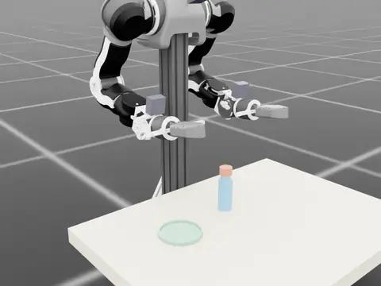

# AIRSEAI 2.0

An open-source embodied-AI platform: a dual-arm manipulator with vision-based tactile sensors, one
data pipeline, and two places it runs — sim and the real robot.

**In simulation, this repository.** A bimanual OpenArm with four tactile fingers in Isaac Sim, a
scripted expert per task, LeRobot v3 datasets carrying the tactile channels, ACT training on them,
and policy rollout in the same scenes.

**On the real robot.** The same arms, the same recorded keys, collected by leader-follower
teleoperation. Sim and real do not line up everywhere, and quantifying where they part is why the
benchmark exists.

## The tasks

|                                                                          |                                                                                       |                                                                               |
| :---:                                                                    | :---:                                                                                 | :---:                                                                         |
|       |  |  |
| `stack_cube` — stack one cube on another                                 | `blind_peg_insertion` — insert a peg into a hole that is not where the robot is told  | `sleeve_on_shaft` — slide a squeezable sleeve onto a shaft                    |
|   |                        |          |
| `texture_sort` — sort two balls that differ only in surface, in the dark | `handover` — hand a spring-loaded sleeve between the arms, from one cup to the other  | `cap_unscrew` — hold a bottle, unscrew its cap and place it in a tray         |

---

## 1. Requirements

|           | version                                                               |
| ---       | ---                                                                   |
| OS        | Ubuntu 22.04                                                          |
| Isaac Sim | 5.1.0.0                                                               |
| Isaac Lab | v2.3.2 (`isaaclab` 0.54.2) + `isaaclab_contrib` (TacSL)               |
| Python    | 3.11                                                                  |
| PyTorch   | 2.7.0+cu128                                                           |
| lerobot   | 0.5.1, compatible source installed in `airseai` (dataset format v3.0) |

See the [Isaac Sim 5.1 system
requirements](https://docs.isaacsim.omniverse.nvidia.com/5.1.0/installation/requirements.html) for
minimum hardware requirements and supported drivers.

## 2. Robot asset

The robot asset comes from enactic's
[openarm_isaac_lab](https://github.com/enactic/openarm_isaac_lab). The installer prepares the
bimanual robot with four GelSight fingers and wrist/head cameras at
`assets/usds/openarm_bimanual/openarm_tactile.usd`.

## 3. The environments

The registered scenes include the task environments and `minimal`. The clips at the top of this file
show demonstrations of the task scenes:

| `--env`               | what it is                                                                                                                                                                         |
| ---                   | ---                                                                                                                                                                                |
| `minimal`             | the robot and its four tactile fingers, no furniture. The reference scene for anything that looks like a sensing bug                                                               |
| `stack_cube`          | pick up a cube and stack it on a second one. The template every task layer copies                                                                                                  |
| `blind_peg_insertion` | pick up a peg, find a close-fitting hole by touch under an injected pose error, insert it                                                                                          |
| `sleeve_on_shaft`     | slide a split sleeve onto a shaft, gripping hard enough to carry it but not so hard its bore closes                                                                                |
| `texture_sort`        | tell two similar-looking balls apart by surface and sort them, in light too dim to see the texture                                                                                 |
| `handover`            | pinch a spring-loaded split sleeve out of the orange cup with the left arm, hand it to the right arm, and seat it over the key in the teal cup, holding it open just enough to fit |
| `mug_on_hook`         | carry a mug by its body and hang its handle on a peg                                                                                                                               |
| `cap_unscrew`         | hold a bottle, unscrew its cap with the other hand, and place it in a tray                                                                                                         |

## 4. The pipeline

```text
0 install → 1 preview → 2 collect → 3 convert → 4 train → 5 evaluate
```

### Stage 0 — install

#### NVIDIA driver

Install an NVIDIA driver compatible with your GPU model and the selected Isaac Sim release. Follow
the [Isaac Sim driver
requirements](https://docs.isaacsim.omniverse.nvidia.com/5.1.0/installation/requirements.html). Skip
this step if a compatible driver is already installed.

#### Conda

Skip this step if conda is already installed.

```bash
sudo apt install -y curl
curl -fL -o Miniconda3-latest-Linux-x86_64.sh https://repo.anaconda.com/miniconda/Miniconda3-latest-Linux-x86_64.sh
bash Miniconda3-latest-Linux-x86_64.sh -b -p "$HOME/miniconda3"
```

#### Install the airseai-2.0

The installer asks for four settings. Press Enter to accept the displayed default.

```bash
sudo apt install -y git
git clone git@github.com:AIRSEAI/AIRSEAI-2.0.git ~/AIRSEAI-2.0
cd ~/AIRSEAI-2.0
bash scripts/install_airseai.sh
```

**Options**

| Prompt           | Meaning                        | Default                                               |
| ---              | ---                            | ---                                                   |
| `conda env name` | Environment to create or reuse | `airseai`                                             |
| `conda root`     | Conda installation directory   | Detected installation, falling back to `~/miniconda3` |
| `repo dir`       | AIRSEAI repository directory   | Repository containing the installer                   |
| `output root`    | Directory for generated files  | `outputs/` under the selected `repo dir`              |

#### Activate the installed environment

After installation completes successfully, activate the environment in the terminal used for the
remaining stages:

```bash
source ~/miniconda3/etc/profile.d/conda.sh
conda activate airseai
```

The selected output root is saved as `OUTPUT_ROOT` in this conda environment and loaded
automatically on activation.

### Stage 1 — preview an environment

Task environments use the shared Isaac Lab ManagerBased environment. `--num_envs` defaults to 1.
Larger values create independent copies of the selected task in one Isaac Sim scene and process,
advancing together at each simulation step.

```bash
# Open an interactive view of four environments
python benchmark/run/launch_env.py --env stack_cube --num_envs 4 --gui

# Save a 30-second grid video of four environments
python benchmark/run/launch_env.py --env stack_cube --num_envs 4 \
    --video "$OUTPUT_ROOT/preview/stack_cube.mp4" --steps 1800

# Save a snapshot of four environments
python benchmark/run/launch_env.py --env stack_cube --num_envs 4 \
    --snapshot "$OUTPUT_ROOT/preview/stack_cube.png"
```

### Stage 2 — collect demonstrations

#### Scripted expert

Each task provides a state-machine-based scripted expert for collecting demonstrations. See the
[texture_sort example](example/texture_sort/README.md) for a workflow exploring how demonstration
diversity and dataset composition can affect task success rates.

```bash
# Run 50 attempts in one environment, saving review and tactile preview videos
RENDER=1 bash scripts/run_collect.sh stack_cube 50 \
    "$OUTPUT_ROOT/raw/stack_cube_expert"

# Run 200 total attempts across four environments with the same video outputs
NUM_ENVS=4 RENDER=1 \
    bash scripts/run_collect.sh stack_cube 200 \
    "$OUTPUT_ROOT/raw/stack_cube_expert_parallel"
```

**Options**

| Option        | Meaning / default                                                     |
| ---           | ---                                                                   |
| `NUM_ENVS`    | Concurrent environments; `1`                                          |
| `GPUS`        | One GPU ID for native vector tasks; `0`                               |
| `SEED`        | Collection seed; `7`                                                  |
| `INIT_STATES` | Optional initial-state JSON; absent means independent draws           |
| `RENDER=1`    | Record review videos                                                  |
| `PREVIEWS=1`  | Add depth heatmaps and shear-field arrow videos for visual inspection |

The requested count is the total number of attempts, not successful episodes, for both single- and multi-environment collection. By default, failed trajectories are excluded from the training dataset and are not replaced by extra attempts. For example, 50 attempts with 42 successes produce a dataset of 42 episodes. Failed-attempt diagnostics remain under `<dataset>/run/attempts/`.

#### Keyboard and VR teleoperation (Todo)

```bash
python benchmark/teleop/run_teleop.py --task stack_cube \
    --teleop_device keyboard --episodes 10 \
    --dataset "$OUTPUT_ROOT/raw/stack_cube_teleop"
```

**Outputs**

| Output         | Path                                                            |
| ---            | ---                                                             |
| Raw dataset    | `$OUTPUT_ROOT/raw/stack_cube_teleop/`                           |
| Episode report | `$OUTPUT_ROOT/raw/stack_cube_teleop_run/stack_cube_teleop.json` |
| Review videos  | `$OUTPUT_ROOT/raw/stack_cube_teleop/review/third_person/`       |

### Stage 3 — convert and combine datasets

Combine multiple demonstration datasets from stage 2:

```bash
DATASET=stack_cube_merged bash scripts/run_convert.sh \
    "$OUTPUT_ROOT/raw/stack_cube_{#1}" \
    "$OUTPUT_ROOT/raw/stack_cube_{#2}"
```

**Options**

| Option     | Meaning / default                                                                     |
| ---        | ---                                                                                   |
| `DATASET`  | Output dataset name; required for multiple inputs, otherwise the input directory name |
| `VARIANTS` | Space-separated variants; `vision tacff tacrgb`                                       |
| `FORCE=1`  | Regenerate existing outputs; otherwise skip them                                      |

**Outputs**

| Variant  | Inputs                         | Combined output                                   |
| ---      | ---                            | ---                                               |
| `vision` | Cameras and robot state        | `$OUTPUT_ROOT/datasets/stack_cube_merged_vision/` |
| `tacff`  | Vision plus force-field images | `$OUTPUT_ROOT/datasets/stack_cube_merged_tacff/`  |
| `tacrgb` | Vision plus tactile RGB images | `$OUTPUT_ROOT/datasets/stack_cube_merged_tacrgb/` |

One or more input directories are accepted; `DATASET` names the combined output. Source recordings remain unchanged. Inputs must have compatible task, action, and observation definitions.

### Stage 4 — train a policy

Train a policy on the converted dataset from stage 3.

```bash
DATASET=stack_cube_merged VARIANT=tacff POLICY=act GPU=0 \
    STEPS=50000 SEED=1000 bash scripts/run_train.sh
```

**Options**

| Option                   | Meaning / default                                           |
| ---                      | ---                                                         |
| `DATASET`                | Dataset name from stage 3                                   |
| `VARIANT`                | `vision`, `tacff`, or `tacrgb`                              |
| `POLICY`                 | LeRobot policy type; `act`                                  |
| `GPU`                    | Training GPU; defaults to the GPU with the most free memory |
| `STEPS`                  | Training steps; `50000`                                     |
| `SEED`                   | Training seed; `1000`                                       |
| `BATCH` / `WORKERS`      | Batch size / loader workers; `8` / `8`                      |
| `SAVE_FREQ` / `LOG_FREQ` | Checkpoint / log interval; `10000` / `200` steps            |
| `DS`                     | Explicit converted dataset path                             |
| `BASE`                   | Training output root; defaults to `OUTPUT_ROOT`             |
| `DEFAULT_PY`             | Python executable from the training environment             |

**Outputs**

| Output      | Path                                                                |
| ---         | ---                                                                 |
| Checkpoints | `$BASE/train/${DATASET}_${VARIANT}_${POLICY}_s${SEED}/checkpoints/` |
| Log         | `$BASE/logs/train_${DATASET}_${VARIANT}_${POLICY}_s${SEED}.log`     |

Repeat with `VARIANT=tacrgb` or `tacff` and the matching `DS` path. ACT is the initial baseline. Other model families may require additional model configuration and dependencies.

### Stage 5 — evaluate

`INIT_STATES` selects the saved initial states, including object poses, robot joint positions and
task-specific settings. Each state is evaluated once, without retries or resampling; the file
determines the episode count.

```bash
CKPT="$OUTPUT_ROOT/train/stack_cube_merged_tacff_act_s1000/checkpoints/last/pretrained_model"

# Evaluate the saved stack-cube states sequentially
INIT_STATES=meta/init_states/stack_cube.json NUM_ENVS=1 \
    OUT="$OUTPUT_ROOT/eval/stack_cube_merged_tacff_act_s1000_envs_1" \
    bash scripts/run_eval.sh stack_cube "$CKPT"

# Evaluate the same states across four environments on one GPU
INIT_STATES=meta/init_states/stack_cube.json NUM_ENVS=4 \
    OUT="$OUTPUT_ROOT/eval/stack_cube_merged_tacff_act_s1000_envs_4" \
    bash scripts/run_eval.sh stack_cube "$CKPT"
```

**Options**

| Option           | Meaning / default                                                   |
| ---              | ---                                                                 |
| `INIT_STATES`    | Initial-state JSON; defaults to `meta/init_states/<task>.json`      |
| `NUM_ENVS`       | Concurrent environments; `1`                                        |
| `GPU`            | GPU to use; otherwise uses the current CUDA visibility              |
| `OUT`            | A new output directory for each evaluation                          |
| `VIDEO=1`        | Save `visual_review/mosaic.mp4` and frame metadata under `OUT`      |
| `N_ACTION_STEPS` | Actions per inference; `100`, must not exceed checkpoint chunk size |

**Outputs**

| Output            | Path                    |
| ---               | ---                     |
| Evaluation report | `$OUT/eval_report.json` |
| Per-state records | `$OUT/attempts/`        |

#### Generate new initial states

To create a separate evaluation set, sample up to 80 candidate starts and keep 50 that the scripted
expert completes:

```bash
python benchmark/run/make_init_states.py --task stack_cube \
    --count 50 --max-candidates 80 --seed 0 --expert --num_envs 4 \
    --headless \
    --out "$OUTPUT_ROOT/custom_states/stack_cube.json"
```

Each candidate is settled, frozen and restored before the expert runs. Only successful candidates
enter the final set. To generate without an expert:

```bash
python benchmark/run/make_init_states.py --task stack_cube \
    --count 50 --max-candidates 80 --seed 1 --no-expert --num_envs 4 \
    --out "$OUTPUT_ROOT/custom_states/stack_cube_unfiltered.json" \
    --headless
```

To evaluate the new set, replace `INIT_STATES` in the commands above with
`"$OUTPUT_ROOT/custom_states/stack_cube.json"` and choose a new `OUT` directory.

## 5. What the dataset contains

LeRobot **v3.0**, readable by stock `LeRobotDatasetMetadata`; the tactile `data` features need
`lerobot_tactile_ext` to decode.

| key                                                        | dtype               | shape     | what it is                                         |
| ---                                                        | ---                 | ---       | ---                                                |
| `observation.images.base` / `.left_wrist` / `.right_wrist` | video               | 480×640×3 | cameras                                            |
| `observation.images.{sensor}_tactile` ×4                   | video               | 288×384×3 | Taxim tactile RGB render                           |
| `observation.depth.{sensor}_tactile` ×4                    | data (uint16, ffv1) | 288×384×1 | gel penetration depth, mm                          |
| `observation.ff_shear.{sensor}_tactile` ×4                 | data (uint16, ffv1) | 288×384×2 | TacSL shear force field (x, y), ×1e3               |
| `observation.state` / `action`                             | float32             | 16        | 7 joints (deg) + gripper (mm) per arm, right first |
| `is_success` / `is_intervention` / `control_mode`          | int64               | 1         |                                                    |

`{sensor}` ∈ `{left,right}_hand_{index,middle}_finger`. The quantisation profile is recorded in each
`data` feature's `info`, so no out-of-band constants are needed.

Stage 3 turns a recording into three training datasets — each a new, separate dataset; the recording
is never modified. Same columns as above; the last column says which recorded key each one comes
from.

**`vision`** — cameras and proprioception only:

| key                                                        | dtype   | shape     | from        |
| ---                                                        | ---     | ---       | ---         |
| `observation.images.base` / `.left_wrist` / `.right_wrist` | video   | 480×640×3 | as recorded |
| `observation.state` / `action`                             | float32 | 16        | as recorded |

**`tacrgb`** — `vision` plus the tactile camera images:

| key                                           | dtype | shape     | from                                                                            |
| ---                                           | ---   | ---       | ---                                                                             |
| `observation.images.tacrgb_{arm}_{finger}` ×4 | video | 288×384×3 | `observation.images.{sensor}_tactile`, decoded and re-encoded under the new key |

**`tacff`** — `vision` plus the force field packed as an image:

| key                                          | dtype | shape     | from                                                                                                                        |
| ---                                          | ---   | ---       | ---                                                                                                                         |
| `observation.images.tacff_{arm}_{finger}` ×4 | video | 288×384×3 | R = `observation.depth` / 3 mm; G, B = `observation.ff_shear` x, y mapped from [−6, +6] onto [0, 1] (`tactile_codec.tacff`) |

`{arm}_{finger}` ∈ `{right,left}_{middle,index}`.

Reading the `data` streams back (sim and real use the same codec; only the key names differ):

```python
import json
from pathlib import Path
from lerobot_tactile_ext import decode_data_frames
from tactile_codec import QuantProfile, dequantize

root = Path("~/stack_cube_dataset").expanduser()          # a stage-2 recording
info = json.load(open(root / "meta/info.json"))
key = "observation.depth.right_hand_index_finger_tactile"
spec = info["features"][key]

u16 = decode_data_frames(root / "videos" / key / "chunk-000/file-000.mkv",
                         original_channels=spec["info"]["original_channels"])
depth_mm = dequantize(u16, QuantProfile(**spec["info"]["quant"]))
```

## 6. Layout

```
src/sim/            simulation: tactile sensing, robot asset builder,
                    envs/ (scenes) and tasks/ (experts, registry),
                    init_state.py (frozen evaluation states)
meta/               data the benchmark is pinned to: init_states/ (the
                    evaluation set) and baseline/ (the expert's own score)
src/tactile_codec/  quantisation profiles (float mm <-> uint16)
src/lerobot_tactile_ext/  ffv1 codec + LeRobot v3 dataset writer
src/gym_airseai/    the tasks as a gym environment, for lerobot
src/lerobot_airseai/  the matching lerobot environment config
scripts/run_*.sh    the pipeline entry points (collect, convert, train, eval)
                    plus install_airseai.sh
benchmark/run/      launch_env, collect_dataset, make_init_states, build_asset,
                    render_previews, make_* (task assets), verify_codec
benchmark/tasks/    run_expert.py, the shared expert runner
benchmark/teleop/   run_teleop.py, demonstrations driven by hand
benchmark/policy/   BC pipeline: dataset conversion, policy server
benchmark/eval/     evaluate.py, the policy evaluator
.githooks/          shared git hooks (DCO sign-off)
```

## 7. Simulation vs. the real robot

The hardware the simulation models:

| subsystem    | what it is                                                                 |
| ---          | ---                                                                        |
| arms         | OpenArm dual-arm, 7 DoF each, leader-follower teleoperation for collection |
| end effector | two-finger electric gripper per arm                                        |
| cameras      | RealSense D435 at the head, a D405 at each wrist                           |
| tactile      | vision-based fingertips (Daimon DM-Tac), four of them                      |
| compute      | Jetson AGX Orin on the robot, RTX workstation for training                 |

It records the same cameras, state and action as the simulation, and these tactile keys per sensor:

| key                                        | dtype   | shape     | sim                                                   | real                                    |
| ---                                        | ---     | ---       | ---                                                   | ---                                     |
| `observation.images.{sensor}_tactile`      | video   | 288×384×3 | Taxim render                                          | camera                                  |
| `observation.depth.{sensor}_tactile`       | data    | 288×384×1 | gel penetration, mm                                   | gel penetration, mm                     |
| `observation.ff_shear.{sensor}_tactile`    | data    | 288×384×2 | TacSL shear **force** field (x, y), uncalibrated ×1e3 | —                                       |
| `observation.shear.{sensor}_tactile`       | data    | 288×384×2 | —                                                     | shear **displacement** field (x, y), mm |
| `observation.deformation.{sensor}_tactile` | data    | 288×384×2 | —                                                     | deformation field (x, y), mm            |
| `observation.state.force_{sensor}`         | float32 | 6         | —                                                     | resultant wrench                        |

Tactile RGB and depth line up. The tangential channel does not: the sim's `ff_shear` is a force in
TacSL's own units, the real `shear` is a displacement in millimetres — different physical
quantities, carrying different names on purpose so that a policy or a converter cannot mistake one
for the other.

`PREVIEWS=1` (stage 2) adds `observation.images.{depth,ff_shear}_{sensor}` renders beside the raw
streams on sim data, as the real recorder does for its own fields.

## 8. Contributing

Every commit must carry a Developer Certificate of Origin (DCO) sign-off, or the pull request's DCO
check fails. The repo ships a hook that adds it for you. Enable it once per clone:

```bash
git config core.hooksPath .githooks
```

From then on every `git commit`, from the terminal or an editor, ends with

```
Signed-off-by: Your Name <you@example.com>
```

taken from `user.name` and `user.email`. That email must match the one on your GitHub account.

Check it works:

```bash
git commit --allow-empty -m "test sign-off"
git log -1 --format=%B        # the last line is Signed-off-by
git reset --soft HEAD~1       # drop the test commit, keep your changes
```

The hook does not run on rebase or cherry-pick. To sign commits that are already on your branch,
rewrite them and force-push:

```bash
git rebase --signoff main
git push --force-with-lease
```
